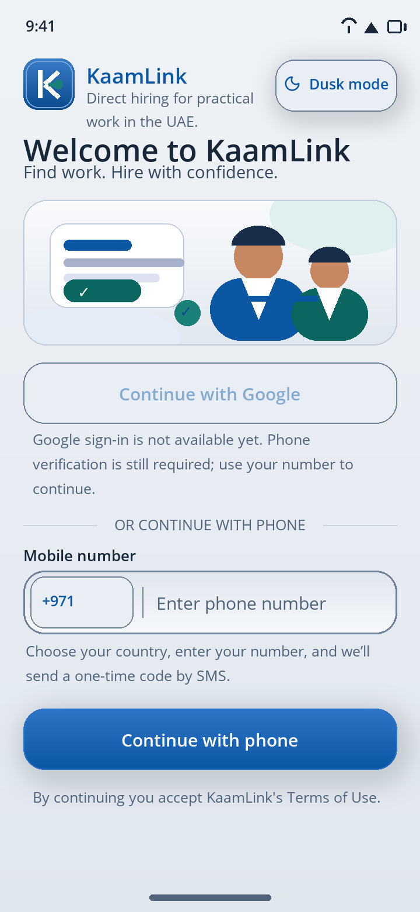
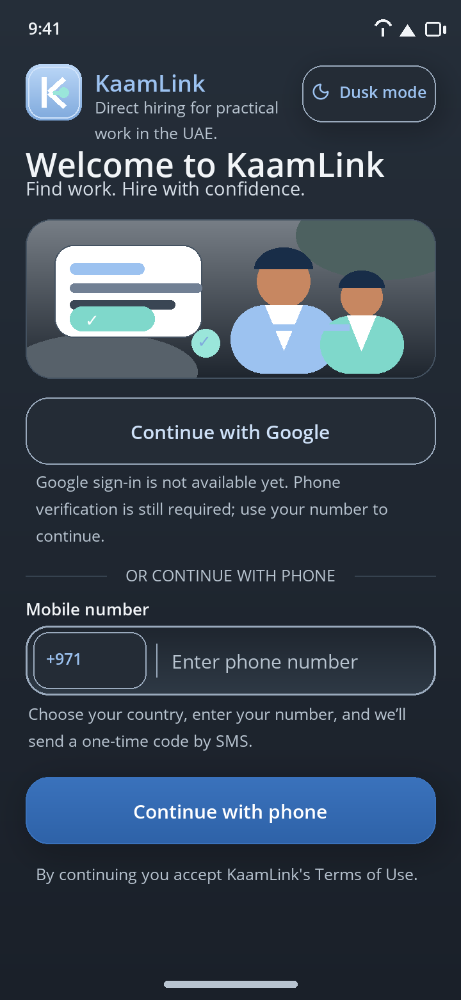

# Login screen — current and upgraded

These are **faithful static renderings** of the current XAML layout, generated by
`tools/render-login-preview.py` from the shipped `AppStrings.resx` and the light /
dusk palette files. They are not device screenshots and not the stale checked-in
`mockups/02-login.png` from the first flat design pass.

## Current login screen (before this pass)

| Light (default Clay) | Dusk |
|---|---|
|  |  |

## After the senior-developer upgrade

Richer three-stop clay gradients on page/card surfaces, a cobalt/navy adaptive
icon, a gradient hero illustration, corrected theme-shadow dispatching, faster
`CollectionView` measurement, and distinct offline/no-network/setup error states.
Layout and copy are unchanged: Google stays honestly disabled.

| Light (default Clay) | Dusk |
|---|---|
|  |  |

## Rich modern app icon

The actual shipped assets are `Resources/AppIcon/appicon.svg`,
`Resources/AppIcon/appiconfg.svg`, `Resources/Images/kaamlink_mark.svg`,
`Resources/Images/login_hero.svg` and `Resources/Splash/splash.svg`. Underscores
are required: MAUI Resizetizer rejects hyphens in Android image resource names.
This is the design preview:

## Connectivity status

The app-side causes are fixed and gated: no reserved `.invalid` Release host, a
build-time public HTTPS URL, a Debug-only LAN policy, a shared 15-second timeout,
one `IHttpClientFactory`-managed auth client, and clear localized errors for
offline / no-internet / server-not-configured states.

End-to-end production OTP still needs a **public HTTPS backend URL** and a
**production SMS provider**. See
[`docs/connectivity-and-release-configuration.md`](../connectivity-and-release-configuration.md).
