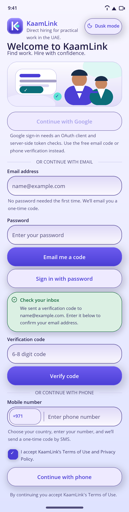
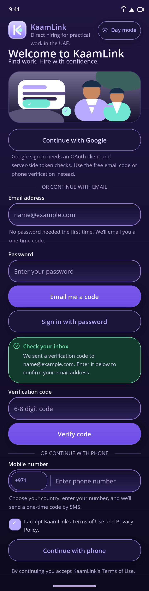
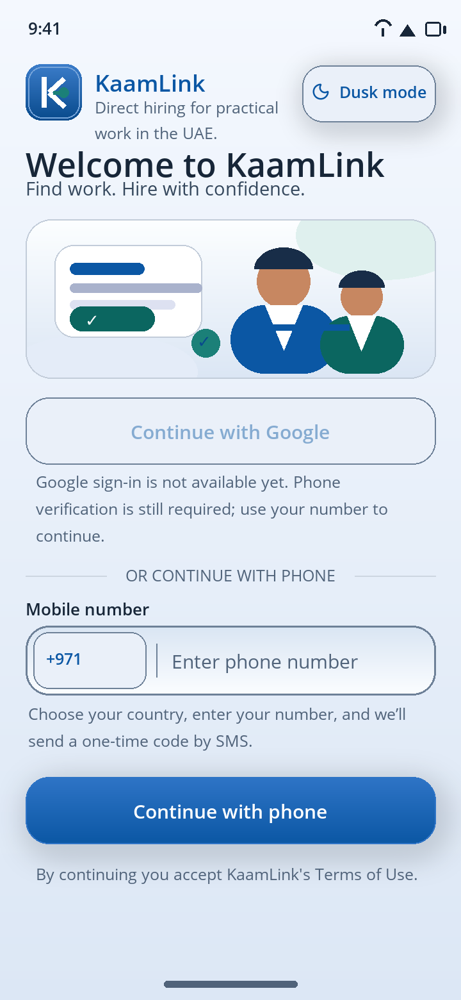
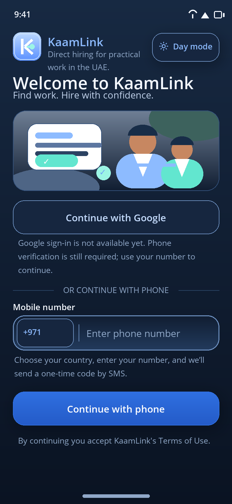
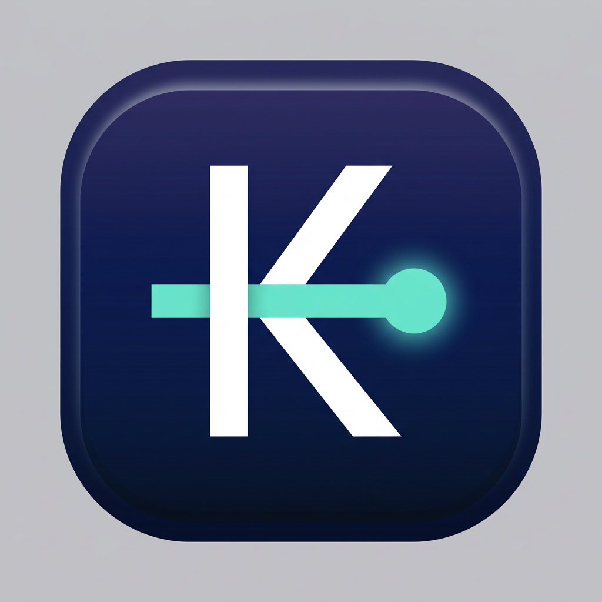

# Login screen — Aurora Clay, email OTP and password setup

These are **faithful static renderings** of the current XAML layout, generated by
`tools/render-login-preview.py` from the shipped `AppStrings.resx` and the light /
dusk palette files. They are visual aids, not device screenshots and not the stale
checked-in `mockups/02-login.png` from the first flat design pass.

## Current login screen (after the OTP pass)

The current screen has an **enabled, free passwordless signup/login path**, a
**tickable terms checkbox**, an **inline email OTP code field**, **optional
password creation after first confirmation**, and later **password sign-in**.
Google is still disabled with an honest explanation.

| Light (Aurora Clay) | Dusk (Aurora Dusk) |
|---|---|
|  |  |

### What changed

- **No more empty “confirm your email address” click page.** The old Supabase
  magic-link email used `{{ .ConfirmationURL }}`; clicking it on desktop could
  land on an unusable page. The active flow now uses an emailed **one-time code**.
  Supabase’s `site_url` was also changed to a hosted `auth-confirmed` Edge
  Function page, so any legacy link still shows a real page.
- **Email OTP is the primary CTA.** The app calls Supabase GoTrue
  `POST /auth/v1/otp`, the user types the 6–8 digit code in the app, and
  `POST /auth/v1/verify` exchanges it for a Supabase session.
- **Password creation after first confirmation.** The backend reads
  `user_metadata.password_set`; when it is false, the app shows a password +
  confirm-password screen. `PUT /auth/v1/user` saves the password and sets
  `password_set: true`. “Maybe later” skips it.
- **Password sign-in for later sessions.** Returning users can enter email +
  password; the app calls `POST /auth/v1/token?grant_type=password` and then the
  KaamLink exchange endpoint.
- **Continue with Google is explained, not silently greyed out.** It stays
  disabled because there is no Google Cloud OAuth client and no server-side
  ID-token verification/account linking.
- **Terms and Conditions is a real `CheckBox`.** All sign-in paths are blocked
  until it is ticked. Acceptance is persisted so the email-app round trip still
  works.
- **Aurora palette:** indigo/violet brand gradients, cyan/mint accents, lavender
  clay surfaces in light mode and rich midnight-violet surfaces in dusk mode.
  All 55 static contrast checks still pass.
- **Latest rounded shapes:** 24dp buttons, 28dp cards/banners, 22dp inset
  fields, pill icon tiles, and a refreshed clay shadow ramp. Day/Dusk uses native
  `Button`s with compiled palette dictionaries.
- Legacy magic-link deep links are still parsed as a fallback, but OTP is the
  primary path.
- Offline / no-internet / server-not-configured / invalid-code / rate-limit
  states have localized EN/AR copy.

## Previous rich-navy / magic-link pass

The older `login-current-*` and `login-upgraded-*` PNGs document the preceding
electric-blue/mint midnight-navy and magic-link pass. They are kept for
provenance; they are not the current screen.

| Previous light | Previous dusk |
|---|---|
|  |  |

## Rich modern app icon

The actual shipped assets are `Resources/AppIcon/appicon.svg`,
`Resources/AppIcon/appiconfg.svg`, `Resources/Images/kaamlink_mark.svg`,
`Resources/Images/login_hero.svg` and `Resources/Splash/splash.svg`. They use the
aurora violet/indigo/mint gradient language. This preview is generated by
`tools/render-app-icon-preview.py`:



## Supabase hosted-template step still required

The connected Supabase tool can update supported auth flags but cannot edit
hosted email-template fields. The repo now includes
`tools/configure-supabase-otp-templates.py`, which changes both the
**Magic Link or OTP** and **Confirm signup** templates to render `{{ .Token }}`
instead of a link. Run it once with a scoped Management API PAT:

```bash
export SUPABASE_ACCESS_TOKEN=sbp_your_scoped_token_here
python3 tools/configure-supabase-otp-templates.py
```

Do not paste the token into chat or commit it. Full steps are in
[`docs/email-magic-link-setup.md`](../email-magic-link-setup.md). Until that step
runs, Supabase’s default OTP length is 8; the app accepts 6–8 digits.

## Connectivity status

App-side causes remain fixed and gated: no reserved `.invalid` Release host, a
build-time public HTTPS URL, Debug-only LAN cleartext policy, a shared 15-second
timeout, one `IHttpClientFactory`-managed auth client, and clear localized errors.

End-to-end production auth still needs a **public HTTPS backend URL** (passed with
`-p:KaamLinkApiBaseUrl=https://.../`), the Phase 06 backend migration, the
Supabase OTP template step above, and a **production SMS provider** for phone OTP.
Supabase’s built-in email provider is free but rate-limited; configure
**custom SMTP** before production magic-link/OTP traffic. See
[`docs/connectivity-and-release-configuration.md`](../connectivity-and-release-configuration.md)
and [`docs/email-magic-link-setup.md`](../email-magic-link-setup.md).

## Verification

`bash tools/verify-all.sh` passes every static gate, including the updated
`tools/verify-email-auth.py` (119 checks) and 62 injected-defect negative tests.
See [`06-aurora-email-auth-report.md`](06-aurora-email-auth-report.md) for the
full table. A .NET/Android build, XamlC compilation, backend startup, hosted
template PATCH, live Supabase email delivery, and a device OTP/password round
trip were **not** performed in this environment.
